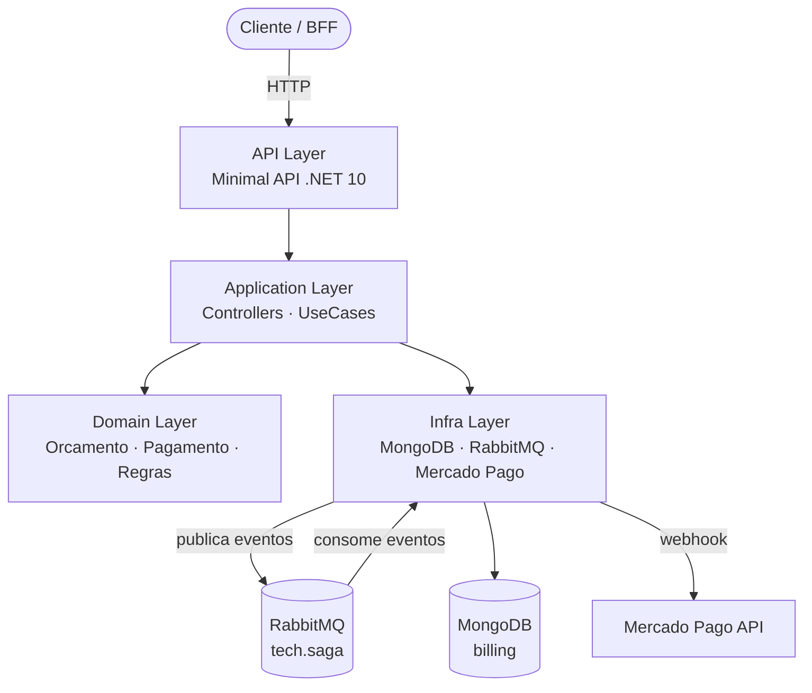

# TechChallenge.Billing — Microsserviço de Orçamentos e Pagamentos

> Fase 4 — FIAP SOAT · Arquitetura de Microsserviços com Saga Pattern

Microsserviço responsável pela **geração de orçamentos, aprovação/rejeição e processamento de pagamentos** via Mercado Pago, parte do sistema TechChallenger (oficina mecânica com escala nacional).

---

## 🔗 Repositórios do TechChallenger

| Serviço | Repositório | Responsabilidade |
|---------|-------------|------------------|
| OS Service | [TechChallenge.OS](https://github.com/TechChallenge01/TechChallenge.OS) | Ciclo de vida das Ordens de Serviço |
| **Billing Service** ← *este* | [TechChallenge.Billing](https://github.com/TechChallenge01/TechChallenge.Billing) | Orçamentos e pagamentos (Mercado Pago) |
| Cadastro Service | [TechChallenge.Cadastro](https://github.com/TechChallenge01/TechChallenge.Cadastro) | Clientes, produtos e categorias |
| Estoque Service | [TechChallenge.Estoque](https://github.com/TechChallenge01/TechChallenge.Estoque) | Reserva e liberação de peças |
| Execução Service | [TechChallenge.Execucao](https://github.com/TechChallenge01/TechChallenge.Execucao) | Fila de execução e reparos |
| BFF | [TechChallenge.bff](https://github.com/TechChallenge01/TechChallenge.bff) | Gateway + Frontend React |

---

## 🏗️ Arquitetura deste repositório



**Camadas (Clean Architecture):**

| Camada | Conteúdo |
|--------|----------|
| `Domain` | `Orcamento`, `Pagamento`, status, regras de negócio |
| `Shared` | DTOs, interfaces compartilhadas |
| `Application` | Controllers, UseCases (gerar/aprovar/rejeitar orçamento, confirmar/estornar pagamento) |
| `Infra` | MongoDB, RabbitMQ consumer/publisher, integração Mercado Pago |
| `API` | Endpoints Minimal API, Program.cs, webhook |

**Deploy:** AWS ECS Fargate · cluster `techchallenge` · região `us-east-1`

---

## 🎯 Objetivo da Fase 4

- Refatorar a aplicação monolítica em microsserviços independentes
- Implementar o **Saga Pattern Coreografado** via RabbitMQ para consistência distribuída
- Integrar com **Mercado Pago** para processamento real de pagamentos via webhook
- Pipeline CI/CD independente com testes automatizados e deploy no ECS Fargate
- Monitoramento e observabilidade com **CloudWatch** e **Datadog**

---

## 🔄 Saga Pattern — Papel do Billing

O Billing é o **árbitro financeiro** da Saga: recebe o diagnóstico, gera o orçamento, aguarda aprovação do cliente e processa o pagamento via Mercado Pago.

**Exchange:** `tech.saga` (Topic, durable) · Broker: RabbitMQ 3.13 no EC2 `100.24.30.116`

### Eventos consumidos por este serviço

| Routing Key | Fila | Ação |
|-------------|------|------|
| `diagnostico.concluido` | `billing.diagnostico.concluido` | Gera orçamento automaticamente |
| `execucao.finalizada` | `billing.execucao.finalizada` | Registra valor final, encerra cobrança |
| `execucao.falhou` | `billing.execucao.falhou` | Registra falha, pode acionar estorno |

### Eventos publicados por este serviço

| Routing Key | Quando | Payload |
|-------------|--------|---------|
| `orcamento.gerado` | Orçamento criado a partir do diagnóstico | `{ OrcamentoId, OrdemServicoId, ValorEstimado }` |
| `orcamento.aprovado` | Cliente aprova o orçamento | `{ OrcamentoId, OrdemServicoId }` |
| `orcamento.rejeitado` | Cliente rejeita o orçamento | `{ OrcamentoId, OrdemServicoId, Motivo }` |
| `pagamento.confirmado` | Mercado Pago confirma pagamento (webhook) | `{ PagamentoId, OrdemServicoId }` |
| `pagamento.falhou` | Mercado Pago reporta falha | `{ PagamentoId, OrdemServicoId, Motivo }` |
| `pagamento.estornado` | Pagamento estornado | `{ PagamentoId, OrdemServicoId }` |

---

## ⚙️ Pré-requisitos

**Execução local:**
- [.NET 10 SDK](https://dotnet.microsoft.com/download/dotnet/10.0)
- [Docker Desktop](https://www.docker.com/products/docker-desktop/)
- MongoDB 7.0 (via Docker ou Atlas)
- RabbitMQ 3.13 (via Docker)
- Conta Mercado Pago (sandbox) para testes de pagamento

**Infraestrutura AWS:**
- AWS CLI configurado (`aws configure`)
- Terraform ≥ 1.9
- Acesso ao cluster ECS `techchallenge` em `us-east-1`

---

## 🚀 Como Executar

### Local com Docker Compose

```bash
git clone https://github.com/TechChallenge01/TechChallenge.Billing.git
cd TechChallenge.Billing
docker compose up -d
```

Acesse: `http://localhost:5001/scalar` (Scalar API Docs)

### Testes

```bash
dotnet test tests/UnitTests
```

---

## 🔐 Variáveis de Ambiente

| Variável | Descrição | Exemplo |
|----------|-----------|---------|
| `MongoDB__ConnectionString` | URI do MongoDB | `mongodb://localhost:27017` |
| `MongoDB__DatabaseName` | Nome do banco | `billing` |
| `RabbitMQ__Host` | Host do RabbitMQ | `localhost` |
| `RabbitMQ__Username` | Usuário RabbitMQ | `guest` |
| `RabbitMQ__Password` | Senha RabbitMQ | `guest` |
| `Jwt__Key` | Chave JWT (mín. 32 chars) | — |
| `Jwt__Issuer` | Issuer JWT | `TechChallenger` |
| `Jwt__Audience` | Audience JWT | `TechChallenger` |
| `MercadoPago__AccessToken` | Token da API Mercado Pago | — |

Em produção, as variáveis são injetadas pelo Terraform via ECS task definition.

---

## 📡 Endpoints da API

Todos os endpoints (exceto `/health` e `/webhooks/mercadopago`) requerem `Authorization: Bearer <token>`.

| Método | Rota | Descrição |
|--------|------|-----------|
| `GET` | `/health` | Health check |
| `POST` | `/orcamentos` | Gerar orçamento manualmente |
| `GET` | `/orcamentos` | Listar orçamentos (paginado) |
| `GET` | `/orcamentos/{id}` | Buscar orçamento por ID |
| `POST` | `/orcamentos/{id}/aprovar` | Aprovar orçamento |
| `POST` | `/orcamentos/{id}/rejeitar` | Rejeitar orçamento |
| `GET` | `/pagamentos/{id}` | Buscar pagamento por ID |
| `POST` | `/webhooks/mercadopago` | Webhook Mercado Pago (sem auth) |

**Exemplo — Aprovar orçamento:**
```json
POST /orcamentos/3fa85f64-5717-4562-b3fc-2c963f66afa6/aprovar
{}
```

**Exemplo — Rejeitar orçamento:**
```json
POST /orcamentos/3fa85f64-5717-4562-b3fc-2c963f66afa6/rejeitar
{
  "motivo": "Valor acima do esperado"
}
```

---

## 🏭 Infraestrutura

**Deploy:** AWS ECS Fargate · cluster `techchallenge` · `us-east-1`

Infraestrutura como código em `infra/` (Terraform):

| Arquivo | Recurso |
|---------|---------|
| `ecs.tf` | ECS Service + Task Definition |
| `ecr.tf` | Repositório ECR para a imagem Docker |
| `alb.tf` | Application Load Balancer |
| `cloudwatch.tf` | Log groups `/ecs/billing-service` |
| `data-sources.tf` | Data sources (VPC, subnets, cluster ECS) |

```bash
cd infra
terraform init
terraform plan
terraform apply
```

---

## 📦 Kubernetes

Manifestos em `k8s/`:

| Arquivo | Recurso |
|---------|---------|
| `deployment.yaml` | 2 réplicas, liveness/readiness probes |
| `service.yaml` | ClusterIP porta 80 |
| `hpa.yaml` | Auto-scaling 2–5 pods (70% CPU) |

---

## 🔁 CI/CD

| Workflow | Trigger | Jobs |
|----------|---------|------|
| `deploy.yml` | push `main` (src/) | Build → Push ECR → Deploy ECS |
| `quality.yml` | push/PR `main` | Testes unitários → SonarCloud |
| `infra.yml` | push `main` (infra/) | Terraform plan/apply |
| `k8s-deploy.yml` | manual (`workflow_dispatch`) | Deploy EKS |

---

## 🧪 Testes

```bash
dotnet test tests/UnitTests

# Com cobertura
dotnet test tests/UnitTests --collect:"XPlat Code Coverage" --results-directory coverage/
```

- **Cobertura:** fluxos críticos da Saga (orçamento, aprovação, rejeição, pagamento) — relatório no SonarCloud
- **Relatório:** artefato `coverage-report-billing` em cada execução do `quality.yml`
- **SonarCloud:** configurado via secrets `SONAR_TOKEN` e variables `SONAR_PROJECT_KEY`, `SONAR_ORGANIZATION`

---

## 📚 Documentação da API

Scalar UI disponível em:

- **Local:** `http://localhost:5001/scalar`
- **Produção:** via BFF ALB

---

## 📬 Collection Postman

Collection completa (todos os serviços) disponível em:

📂 [`TechChallenge.bff/docs/TechChallenger-Postman-Collection.json`](https://github.com/TechChallenge01/TechChallenge.bff/blob/main/docs/TechChallenger-Postman-Collection.json)

---

## 🗂️ Estrutura do Projeto

```
TechChallenge.Billing/
├── src/
│   ├── Domain/          # Orcamento, Pagamento, status, regras
│   ├── Shared/          # DTOs, interfaces compartilhadas
│   ├── Application/     # Controllers, UseCases
│   ├── Infra/           # MongoDB, RabbitMQ, Mercado Pago webhook
│   └── API/             # Endpoints, Program.cs, webhook handler
├── tests/
│   └── UnitTests/       # Testes unitários (xUnit)
├── k8s/                 # Manifestos Kubernetes
├── infra/               # Terraform (ECS, ECR, ALB, CloudWatch)
└── .github/workflows/   # CI/CD pipelines
```
